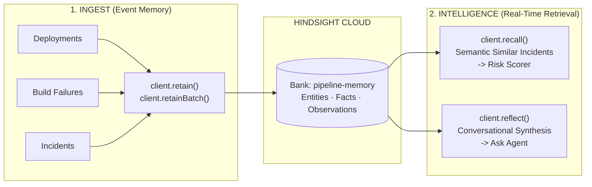
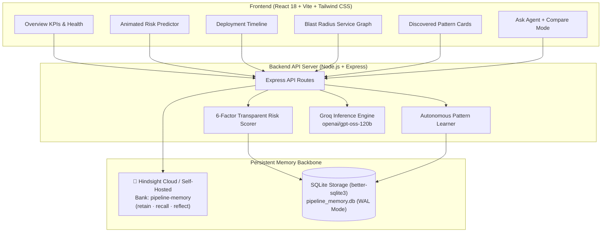

# 🚀 PipelineMemory

**A DevOps Pipeline Agent that remembers every deployment, learns from past failures, and predicts release risk before production.**

[](https://hindsight.vectorize.io/)
[-F55036?style=flat-square)](https://groq.com/)
[](https://vitejs.dev/)
[](https://expressjs.com/)
[-003B57?style=flat-square&logo=sqlite)](https://github.com/WiseLibs/better-sqlite3)
[](LICENSE)

Built for the **AI Agents That Learn Using Hindsight Hackathon** under the **DevOps Pipeline Agent** track.

---

## 📌 The Problem: CI/CD Pipelines Have Amnesia

Every engineering team has lived this nightmare:
1. Someone merges a pull request on Friday afternoon.
2. The build passes all unit tests and linting.
3. It deploys to production and immediately triggers an outage—because an unindexed migration locked active database tables, or a configuration change cascaded into downstream services.

**Why did this happen?** Because CI/CD pipelines run in **stateless isolation**. They forget every previous outage, every post-mortem, every rollback, and every developer pattern.

**PipelineMemory solves this.** It gives the CI/CD pipeline a **long-term cognitive memory bank** powered by **[Hindsight](https://hindsight.vectorize.io)**. Before any deploy hits production, the agent retrieves similar past incidents, evaluates risk across 6 transparent dimensions, and explains *why* using real company history.

---

## 🧠 Why Hindsight is the Core of PipelineMemory

Stateless LLMs cannot solve this problem—asking ChatGPT or Claude *"Why did payments fail?"* returns generic textbook advice about credit card limits. 

Hindsight gives PipelineMemory **persistent, episodic agent memory** across 3 core primitives:



| Hindsight Operation | SDK Method | Role in PipelineMemory |
|---|---|---|
| **Retain** | `client.retain()` / `retainBatch()` | Every deployment, build error, and production incident is converted to rich natural language and stored in the `pipeline-memory` bank. |
| **Recall** | `client.recall()` | When a new change is proposed, semantic vector recall retrieves past similar failures to score risk and cite real evidence. |
| **Reflect** | `client.reflect()` | Powers the natural-language **Ask Agent** panel, synthesizing historical observations across rollouts to diagnose systemic fragility. |

---

## ⚡ The Ultimate Proof: Memory vs. Stateless AI

PipelineMemory includes an interactive **`Compare: Memory vs Stateless AI`** mode in the chat interface:

| Query to Agent | ❌ Stateless AI (Generic LLM) | ✅ PipelineMemory (Powered by Hindsight) |
|---|---|---|
| *"Why did payments fail recently?"* | Recommends checking credit card limits, expired cards, and fraud detection algorithms. *(Completely irrelevant to internal DevOps infrastructure)* | Recalls **Deployments #61 & #62**: Identifies PostgreSQL `ALTER TABLE` deadlock on unindexed foreign keys, notes that payments config changes carry a 60% failure rate cascading into checkout, and cites the 18-minute resolution. |
| *"Is deploying to gateway safe right now?"* | Gives generic checklist: "Make backups, run tests, and check server memory." | Warns that gateway has a 67% dependency failure rate and author Dave's gateway deploys have failed repeatedly due to stale Docker caches. |

---

## 🏗️ System Architecture



---

## 📊 6-Factor Transparent Risk Scoring

Rather than an opaque black-box number, PipelineMemory calculates an interpretable **0–100 risk score** across six weighted dimensions:

| Factor | Weight | Measurement Logic |
|---|---|---|
| **Historical Failure Rate** | 25% | Baseline failure rate for this specific `service` + `change_type` pair |
| **Change Size** | 20% | Total lines modified (changes >500 lines scale exponentially) |
| **Time-of-Week Risk** | 15% | High penalty for Friday afternoon deployments & weekend releases |
| **Recent Failure Streak** | 15% | Consecutive recent failures for this service in recent pipeline history |
| **Downstream Dependencies** | 15% | Total blast radius (number of upstream + downstream services impacted) |
| **Pattern Matches** | 10% | Multipliers from autonomously discovered failure correlations |

---

## 🔍 Autonomously Discovered Patterns

The engine's statistical correlation learner continuously analyzes historical event frequency vs conditional failure rates:

1. **Large Deployments:** Changes with $>500$ lines fail at **$4.4\times$ baseline** ($100\%$ failure rate).
2. **Friday Migrations:** Database migrations deployed on Friday suffer an **$80\%$ failure rate** (lock contention).
3. **Cascading Failure:** Config edits to `payments` carry a **$60\%$ failure rate** and repeatedly cascade outages into `checkout`.
4. **Author/Service Correlation:** Dave's deploys to `gateway` fail $60\%$ of the time due to stale Docker image caching.

---

## 🚀 Quick Start (Run Locally in 60 Seconds)

### 1. Prerequisites
- Node.js 18+ (tested on Node 20 & 22)
- npm 9+

### 2. Clone & Configure
```bash
# Clone the repository
git clone https://github.com/pranaykumarreddy/PipelineMemory.git
cd PipelineMemory

# Configure environment keys
cp .env.example backend/.env
```

Edit [`backend/.env`](file:///Users/pranaykumarreddy/Desktop/Project/PipelineMemory/backend/.env):
```env
# Hindsight Cloud (free signup: https://ui.hindsight.vectorize.io/signup)
HINDSIGHT_BASE_URL=https://api.hindsight.vectorize.io
HINDSIGHT_API_KEY=hsk_your_key_here
HINDSIGHT_BANK_ID=pipeline-memory

# Fast LLM reasoning via Groq (free signup: https://console.groq.com)
GROK_API_KEY=gsk_your_key_here
GROK_MODEL=openai/gpt-oss-120b
```

> **Note:** The app is 100% functional even without API keys! It includes automated fallbacks for offline testing.

### 3. Install, Seed & Launch
```bash
# 1. Install all dependencies (root, backend, and frontend)
npm install

# 2. Seed demo history & bulk-retain into Hindsight memory bank
npm run seed

# 3. Start development servers concurrently
npm run dev
```

- **Frontend Dashboard:** [http://localhost:5173](http://localhost:5173)
- **Backend API:** [http://localhost:3001](http://localhost:3001)
- **Health Check:** [http://localhost:3001/api/health](http://localhost:3001/api/health)

---

## 🎬 2-Minute Demo Walkthrough for Judges

1. **Overview Dashboard ([localhost:5173](http://localhost:5173)):**
   - Notice the live **Hindsight Active** badge in the sidebar footer (`Bank: pipeline-memory`).
   - Review high-level KPIs, 30-day failure rate bars, and per-service health metrics.
2. **Predict Risk ([localhost:5173/predict](http://localhost:5173/predict)):**
   - Select `service: payments`, `change_type: db_migration`, `lines: 800`, `author: pranay`.
   - Click **Predict Risk** $\rightarrow$ Watch the gauge animate to **High Risk**.
   - Notice the **`Hindsight Semantic Recall`** badge surfacing past ALTER TABLE deadlocks.
   - Read the sub-second Groq explanation highlighting exact mitigation actions.
3. **Compare Memory vs. Stateless AI ([localhost:5173/ask](http://localhost:5173/ask)):**
   - Toggle **`Compare: Memory vs Stateless AI`**.
   - Ask: *"Why did payments fail recently?"*
   - Watch the stark contrast: Stateless AI guesses credit-card issues, while Hindsight cites the exact PostgreSQL deadlock and schema collisions.
4. **Service Graph & Blast Radius ([localhost:5173/graph](http://localhost:5173/graph)):**
   - Click `payments` to visualize the cascading blast radius edge to `checkout`.

---

## 🔌 Real CI/CD Integration (GitHub Actions)

Drop this single step into `.github/workflows/deploy.yml` to block dangerous deployments automatically:

```yaml
- name: Predict Deployment Risk with PipelineMemory
  run: |
    RISK=$(curl -s -X POST https://your-pipeline-memory-host/api/predict \
      -H "Content-Type: application/json" \
      -d '{
        "service": "${{ env.SERVICE_NAME }}",
        "change_type": "db_migration",
        "lines_changed": ${{ steps.git-diff.outputs.lines }},
        "author": "${{ github.actor }}"
      }')

    SCORE=$(echo "$RISK" | jq -r .risk_score)
    LEVEL=$(echo "$RISK" | jq -r .risk_level)
    echo "PipelineMemory Risk Level: $LEVEL ($SCORE/100)"

    if [ "$LEVEL" = "High" ]; then
      echo "❌ Deployment blocked by PipelineMemory Agent due to historical failure risk."
      exit 1
    fi
```

---

## 📚 API Reference

### Ingest (Retained to Hindsight)
- `POST /api/deployments` — Record a deployment (retained into Hindsight memory bank)
- `POST /api/build-failures` — Record a build failure linked to a deployment
- `POST /api/incidents` — Record a production incident with downstream impact
- `POST /api/infra-changes` — Record infrastructure/Terraform modifications

### Intelligence & Memory
- `POST /api/predict` — Pre-deploy risk score, factor breakdown, and semantic recall
- `POST /api/ask` — Conversational Q&A with optional `compare: true` side-by-side mode
- `GET  /api/patterns` — Retrieve all discovered risk patterns and evidence counts
- `GET  /api/impact/:service` — Compute blast radius and downstream dependency tree
- `GET  /api/stats` — Real-time aggregate KPIs, MTTR, and failure rate trends
- `GET  /api/health` — System status, active Hindsight bank, and LLM provider

---

## 📦 Hackathon Deliverables

- 📄 **Hindsight Integration Deep-Dive:** [`HINDSIGHT_INTEGRATION.md`](file:///Users/pranaykumarreddy/Desktop/Project/PipelineMemory/HINDSIGHT_INTEGRATION.md)
- 🎥 **Demo Video:** [Link to Demo Video]
- 📝 **Technical Article:** [Link to Published Article]
- 💬 **Social Media Announcement:** [Link to LinkedIn/X Post]

---

## 📄 License

MIT License — free for open-source and commercial use.
